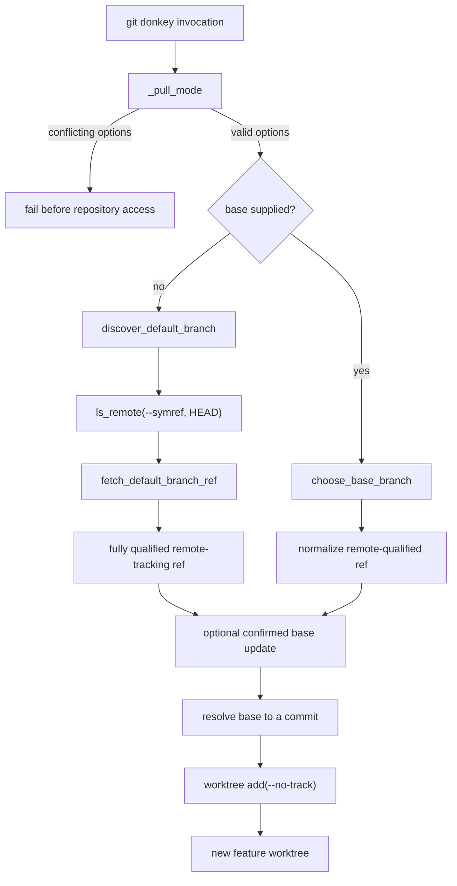

# Default bases and explicit pull modes

For screen readers: The following flowchart shows how `git donkey` validates
its options, selects a base branch, optionally updates that base, and creates
the new worktree.

_Figure 1: git-donkey base selection and worktree creation flow._

## Decision

An omitted `git donkey` base means the fetched default branch on the principal
remote, not a branch in the primary checkout. The principal remote remains the
first configured remote, preserving the existing discovery rule.

The workflow queries the remote's advertised symbolic `HEAD` and explicitly
fetches that branch into its fully qualified remote-tracking reference. This
avoids relying on a stale local `remote/HEAD` alias and supports repositories
whose normal fetch configuration excludes the default branch. Failure to
identify or fetch the default branch is an error, not permission to guess
`main` or use local work. An explicit base bypasses default-branch discovery.

Before creating a new branch, the selected base is resolved to a commit object
ID. Worktree creation uses that ID with `--no-track`, so a new feature branch
does not accidentally track the remote's default branch. Existing local and
remote feature branches retain their separate reuse and tracking behaviour.

## Explicit base resolution

An explicit base is resolved in a fixed order, so every input that worked
before keeps its meaning:

1. A fully qualified `refs/` value is used as written.
2. A literal local branch name is used as that branch, even when the name also
   spells a remote-tracking ref.
3. A configured `<remote>/<branch>` whose `refs/remotes/<remote>/<branch>`
   exists is normalized to that canonical remote-tracking ref.
4. Anything else is resolved with
   `git rev-parse --verify --quiet --end-of-options <base>^{commit}`, which
   accepts a tag, a full or abbreviated commit ID, or another commit-ish.
   `--end-of-options` keeps an option-shaped input such as `--all` from being
   read as a Git option, and `^{commit}` rejects an object that is not a
   commit, such as a tree. Resolution runs in the calling checkout, so a
   revision expression such as `HEAD~2` names the caller's history even from a
   linked worktree.

Only the principal remote is fetched. A base naming another configured remote
resolves against the remote-tracking ref the principal fetch left in place.

A bare branch name that exists only on the principal remote still gains a local
tracking branch, preserving the reuse behaviour. A remote-qualified base and
any other commit-ish resolve without creating a local branch of that name. The
resolved commit ID is passed to `git worktree add --no-track -b`, so a newly
created branch never inherits tracking.

A base that names neither a branch nor a commit exits with code 1. The message
names a bare branch together with the `<remote>/<branch>` ref also checked, and
names a remote-qualified or `refs/` value once, without a doubled remote prefix.

## Local checkout updates

Fetching remote references is distinct from integrating changes into a local
checkout. No local base pull or update prompt occurs by default. Existing
`--no-pull` callers remain supported; that option now explicitly selects the
default behaviour.

`--pull-rebase` enables the previous behind-base confirmation workflow with
`git pull --rebase`. `--pull-ff` enables the same workflow with
`git pull --no-rebase --ff-only`, overriding configured rebase or merge
preferences. These flags and `--no-pull` are mutually exclusive, and conflicts
are rejected before repository access. A declined or non-interactive prompt
continues to skip the update.

An update may run only in the worktree recorded as holding that local base.
When an update is needed but no worktree holds the base, the operation fails
rather than pulling into an unrelated branch in the primary checkout. Local
bases without a remote counterpart retain the existing skip behaviour.

A base that names a tag or commit has no local branch to update; the preflight
accepts it once Git resolves it and skips both the update and the prompt. A
remote-qualified base behaves like an omitted base: the local branch of the
same name may be updated, while the new branch still starts at the
remote-tracking commit. A fully qualified local branch, `refs/heads/<branch>`,
is treated as that local branch for the same comparison. The behind comparison
uses fully qualified refs, so a tag named like the base branch cannot shadow it
in Git's ambiguous short-name resolution.

An omitted base continues to select the remote commit even when an opt-in
update also synchronizes its local counterpart. An explicit local branch base,
including `.` for the calling worktree's branch, selects the local branch after
any confirmed update and therefore can include local commits. A base qualified
by a remote selects the remote-tracking commit after any confirmed update of
the local branch of the same name.

## Verification contract

Real-repository tests cover non-`main` defaults, non-`origin` remotes, a stale
remote `HEAD`, narrow fetch configuration, and an unavailable advertised
default. They also verify preservation of local commits, the index, tracked
modifications, and untracked files during default worktree creation.

Explicit-base tests cover a remote-qualified branch, its canonical
remote-tracking ref, a non-principal configured remote, lightweight and
annotated tags, full and abbreviated commit IDs, a literal local branch whose
name spells a remote ref, and an unresolvable base that must leave neither a
branch nor a worktree behind. Unit tests cover the resolution order,
remote-name matching, and the commit resolution that rejects a tree and an
option-shaped input.

Pull-mode tests cover accepted and declined prompts, actual rebase and
fast-forward operations, divergent histories, hostile pull configuration, and
base branches held in another worktree. They also cover a remote-qualified
base, and tag or commit bases that neither prompt nor update. CLI tests
exercise the Cyclopts parser, including conflicting options. Unit tests cover
advertisement parsing and explicit mode selection.

The change does not alter remote selection, template overlays, `git track`,
branch cleanup, or the confirmation policy for existing updates. `git plonk`
shares this discovery for its completion trunk, so a `git plonk` run fetches
the advertised default branch exactly as base selection does; see the
[plonk cleanup policy](plonk-cleanup-policy.md) for what it then removes.
