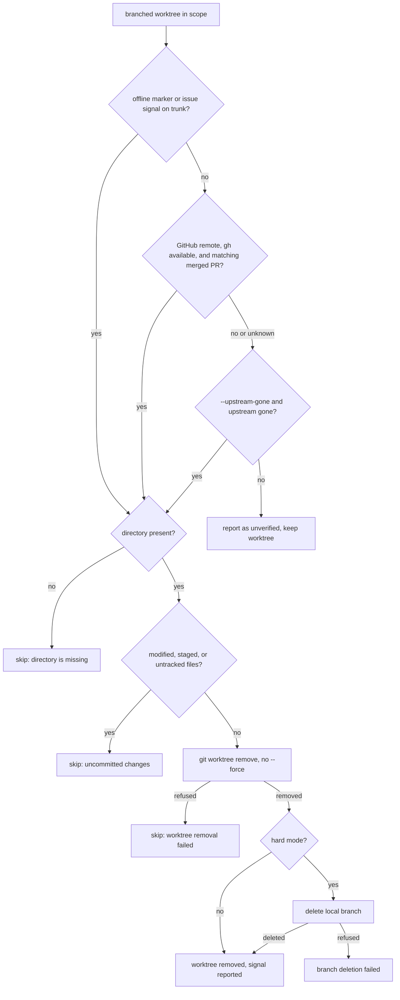

# Plonk cleanup policy

For screen readers: The following flowchart shows how `git plonk` resolves a
candidate's completion from offline history, the GitHub fallback, or the opt-in
upstream check, then how it decides whether the completed worktree is removed,
and when it is left in place with a reason instead. A branch no tier resolves
is reported as unverified and kept. A branch Git refuses to delete in hard mode
is reported separately under `Failed branch deletions:`; the worktree stays
removed, the sweep continues, and the run exits 1.

_Figure 1: git-plonk completion and completed-worktree decision flow._

## Decision

`git plonk` removes a completed worktree only when Git would discard it
unprompted. A completed worktree holding modified, staged, or untracked files
is skipped and reported, and the sweep continues with the remaining worktrees.
Nothing in the command forces a removal.

Removing a worktree is irreversible for uncommitted work, while skipping one
costs a later run. A sweep that stopped at the first dirty candidate would
leave every clean worktree behind it untouched, so the sweep steps around the
candidate it cannot remove and reports it. The report is the contract: the user
learns which worktrees were left alone and why, then decides what to do about
each one.

A candidate that no completion tier resolves is unverified. It is reported and
left in place, because removing work on the strength of a branch name alone is
not safe. Unverified is a decision, not a failure: it leaves the exit status at
0.

Hard mode does not change this. `--hard` means "delete the matching local
branch", and that branch is deleted only after its worktree has been removed,
so a skipped worktree keeps its branch. There is no `--force`-style option in
0.2.0: discarding uncommitted work remains a deliberate, separate action, such
as `git worktree remove --force` followed by `git branch -D`.

In hard mode, a local branch that Git refuses to delete does not stop the
sweep. The worktree still counts as removed, and the branch is listed under its
own `Failed branch deletions:` heading between the removal sections and the
skip section. The sweep continues with the remaining candidates, and the run
exits with status 1.

## Scope

A sweep considers only the linked worktrees Git lists under the worktrees root
that `git donkey` uses. Scope is decided by path, not by provenance: a worktree
created by hand under the root qualifies, and a worktree outside it is never
touched, even when its branch carries a completed marker. `git_donkey.layout`
resolves the root for both commands, as the
[worktree layout design](worktree-layouts.md) records. By default, the root in
a bare repository collection is separate from any directory a session manager
fills, so session worktrees stay out of every mode's reach.

That guarantee follows the default root, not the configuration. Pointing
`donkey.worktreesRoot` at a directory that holds session worktrees brings them
into scope, including removal of their generated directories in soft mode. A
root that contains worktrees created by other tools likewise brings those
worktrees into a sweep.

## Completion tiers

Completion is resolved in three tiers, in this order. The first tier that
produces evidence settles the candidate; the later tiers are not queried for it.

### Offline branch and history signals

Three branch-name shapes are recognized without any network access:

- an issue branch such as `issue-123-short-title` maps to `(#123)`;
- a df12-build roadmap branch such as `roadmap-2-2-1` or
  `roadmap-2-2-1-addendum` maps to its un-namespaced dotted id `(2.2.1)`, with
  two to four numeric components; and
- a legacy roadmap branch such as `road-1-2-3a-4-short-title` maps to
  `(road.1.2.3a.4)`, and a task id may end the name.

An issue branch additionally enables three history matchers. A closing keyword
matches `close`, `fix`, or `resolve` and their inflections, case-insensitively,
with an optional colon, an exact `#N` not followed by a digit, and no
owner/repository prefix. A classic merge commit matches
`Merge pull request #M from <owner>/<exact-branch>`, so the pull-request number
is irrelevant. The branch name itself matches only in a bounded context, never
as a substring of a longer token.

Within one commit message, the completion marker wins over the weaker issue
signals. The history scan stops as soon as every candidate with an offline
matcher has resolved, and candidates without one never keep it running.

### GitHub merged-pull-request fallback

A branch no offline signal resolves may still have landed through a pull
request whose head branch is purely descriptive. The fallback asks the
authenticated `gh` CLI for one read-only
`gh pr list --head <branch> --state merged` result. It parses the raw
configured principal-remote URL without applying Git's `insteadOf` rewrites,
because a repository whose transport is rewritten to a local mirror is still a
GitHub repository.

The fallback is enabled by default only when the principal remote is GitHub and
`gh` is installed. A result is accepted only when its head branch, base branch
(the advertised trunk), and head owner all match the query. A failed,
timed-out, malformed, or mismatched response is `unknown`, never `merged`, and
an empty result is a definitive "no merged pull request" rather than a failure.
A missing `gh` is reported once per run as a notice, and the sweep fails closed.
`--no-github` disables the tier explicitly; it is not valid with `--soft`,
which does not judge completion.

### Opt-in upstream-gone check

`--upstream-gone` treats a branch whose configured upstream no longer exists as
completed. The check reads `branch.<name>.remote` and `branch.<name>.merge` and
runs `git ls-remote --exit-code --heads <remote> refs/heads/<branch>`. A zero
exit means the upstream is present, exit status 2 means gone, and any other
outcome is unknown. A branch with no configured upstream is `unset`.

Only `gone` is completion evidence. `unset`, `present`, and `unknown` leave the
candidate unverified, and the summary preserves the distinction. The tier is
opt-in because a deleted branch cannot distinguish a merged change from an
abandoned one; it is an offline approximation, not proof. The flag is not valid
with `--soft`.

### Unverified reasons

A candidate no tier resolves is reported with one fixed reason:

- `no completion signal found`: no offline matcher resolved it, the GitHub
  fallback was unavailable, was disabled, or found no merged pull request, and
  no stronger reason applies.
- `GitHub completion lookup failed`: the fallback was attempted and could not
  produce a trustworthy answer. This reason outranks an upstream result.
- `no upstream branch configured`: the branch was never pushed.
- `upstream branch still exists`: the configured upstream still exists.
- `upstream state unknown`: the remote could not be queried.

## Cleanliness rule

The preflight mirrors the check `git worktree remove` performs itself: a
worktree with modified, staged, or untracked files is refused, while files
matched by `.gitignore` are not counted, so ignored build output never protects
a worktree. Sharing the rule with Git matters in both directions. Refusing
exactly what Git refuses means a candidate is never planned for removal only to
fail, and never left in place when Git would have removed it.

A completed worktree whose directory is gone gets its own reason, because
`uncommitted changes` would be inaccurate for it. The reasons are a fixed
vocabulary:

- `uncommitted changes`: the worktree exists and Git refuses to remove it.
- `worktree directory is missing`: the recorded path is not a worktree.
- `worktree removal failed`: Git refused for another reason; the refusal is
  also reported on stderr and logged.

Skips keep the run's exit code at 0. A skip is a reported decision, not a
failure of the command. A branch Git refuses to delete is reported as a failed
deletion and the run exits 1, unlike a skip.

## Trunk discovery

Completion is judged against the principal remote's advertised default branch,
resolved through `git_donkey.remote_default`, which is the same machinery
`git donkey` uses to select an implicit base. The advertised symbolic `HEAD` is
read with `git ls-remote --symref` and the named branch is fetched explicitly
into `refs/remotes/<remote>/<branch>`; reading the advertisement and fetching
the ref are separate steps, so a query never fetches.

The local `refs/remotes/<remote>/HEAD` alias is never consulted, because a
fetch can leave it naming a branch the remote no longer advertises. Neither is
local `main`, which is not trunk in repositories that default elsewhere.
Sharing the module means the two commands cannot disagree about which branch is
the repository's trunk, which is what makes "completed" mean the same thing to
both. The GitHub fallback also uses the advertised branch as the base branch it
requires a merged pull request to target.

## Reporting

The summary lists removed worktrees, deleted branches, and removed generated
paths under their own headings, then lists every skipped worktree with its
reason, then every unverified worktree with its fixed reason. Each removed or
planned worktree line names the signal that justified it, such as
`completed by marker (#123)`, `completed by merged pull request #61`, or
`completed by gone upstream branch`. A branch Git refused to delete is listed
under its own `Failed branch deletions:` heading, between the removal headings
and the skip list. It is deliberately absent from both the removed-branches and
skipped-worktrees lists. Skips and unverified worktrees are reported in
`--dry-run` runs as well, because a preview that hid them would misrepresent
the run it previews. A run in which every candidate was skipped or left
unverified reports those decisions rather than claiming that no matching
worktrees were found.

## Verification contract

Unit tests drive the workflow with recording fakes and assert that removal is
issued without `--force`, that a dirty candidate is skipped while its clean
sibling is still removed, and that a skipped candidate keeps its branch in hard
mode. Tests also assert that a refused branch deletion keeps the later
candidates running, keeps the worktree in the removed list, keeps the branch
out of both the removed-branches and skipped-worktrees lists, exits 1, and
records a bounded failure observation. A parameterized test compares the
preflight against a real `git worktree remove` for clean, modified, staged,
untracked, and ignored files, asserting both the classification and the actual
Git outcome. Behavioural tests run the command against real temporary
repositories for a tracked modification, a staged change, an untracked file,
ignored build output, and mixed clean and dirty batches.

Recognition is covered by unit tests over the df12, legacy, and issue grammars,
the closing-keyword, merge-commit, and verbatim-branch matchers, their
negatives and bounds, evidence ordering, shared markers, and early termination.
The GitHub fallback is covered by URL-parsing and process-outcome tests that
assert the argument list, timeout, disabled prompts, closed stdin, head/base/
owner validation, and fail-closed mapping. The upstream check is covered
against real temporary repositories for all four states. Behavioural scenarios
cover df12 and legacy roadmap branches, squash-issue closing keywords, classic
merge commits, cross-repository negatives, a rewritten GitHub remote with
merged and failing `gh` stubs, and gone, present, and never-pushed upstreams
with and without `--upstream-gone`. Every local-remote plonk scenario asserts
that the recording `gh` stub was never invoked.

Trunk discovery is covered by a regression test that points
`refs/remotes/origin/HEAD` at a stale branch and asserts that completion is
still judged against the advertised default, alongside tests for a non-`main`
advertised default, a missing remote, and an unavailable advertisement.
